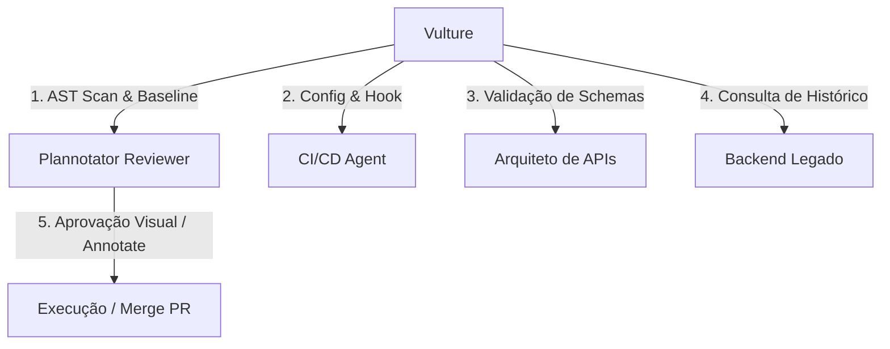

# Plano de Engenharia: Governança e Limpeza Contínua de Código Morto com Vulture

> **Documento de Especificação Técnica, Arquitetura e Blueprint de Execução**  
> **Repositório:** `https://github.com/maestri33/backend.supletivo.net.br`  
> **Autor / Agente Responsável:** Vulture (Especialista em Detecção e Limpeza de Código Morto em Python)  
> **Revisor / Gate:** @Plannotator Reviewer  
> **Status:** FASE 1 CONCLUÍDA (PR #31 Aberto) | FASES 2 A 4 EM EXECUÇÃO  
> **Data:** 17 de Novembro de 2026 (Horário de Brasília: 14:49 BRT)  
> **Alvo:** Zero dead code, baseline automatizada, CI/CD blocking checks e zero regressões.

---

## 1. Visão Geral e Justificativa Técnica

Bases de código Python de alta volatilidade e em evolução acelerada — como o Backend do Supletivo — sofrem naturalmente com o acúmulo de **código zumbi**:
- Imports deixados para trás após migrações de arquitetura (ex.: migração para Django Ninja);
- Parâmetros em assinaturas de funções que deixaram de ser lidos após refatorações de serviços (ex.: visão computacional e sincronização de segredos);
- Funções utilitárias e regras de negócio obsoletadas por mudanças de funil (ex.: `is_approved` em KYC de comprovante de residência);
- Atributos e métodos sem chamadores estáticos que degradam a legibilidade, aumentam a superfície de bugs e oneram a manutenção cognitiva.

O **Vulture 2.16** atua via análise da Árvore Sintática Abstrata (AST) do Python, ponderando achados por níveis de confiança (`confidence` de 60% a 100%). Este plano estabelece o processo formal de governança, auditoria periódica e remediação progressiva, sem quebras de fluxos dinâmicos.

---

## 2. Matriz de Agentes Necessários (RACI / Papéis e Atribuições)

Para garantir que a limpeza de código não comprometa regras de negócio legadas, contratos de API e pipelines de integração, a operação é distribuída entre agentes especializados:



| Agente | ID | Papel RACI | Responsabilidade Principal no Plano |
| :--- | :--- | :---: | :--- |
| **Vulture** | `cmwk8v03vkapqu9he2q6n5ygp` | **R** *(Responsible)* | Execução das varreduras de AST, classificação de confiança, configuração do `[tool.vulture]`, criação de whitelists e submissão dos PRs de limpeza. |
| **Plannotator Reviewer** | `cmwiq8mj82z6aqaz3l5sy0rru` | **A** *(Accountable)* | Disponibilização dos diffs e planos no Plannotator Annotate (`http://localhost:19432`) e Inbox (`http://localhost:55772`), coletando feedback e aprovação humana do Victor antes do merge. |
| **CI/CD** | `cmwjsnyfl7ewspjk2a71zf9lq` | **R / S** *(Support)* | Implementação e manutenção dos workflows no GitHub Actions (`.github/workflows/ci.yml`) e pre-commit hooks para barrar código morto em pull requests. |
| **Arquiteto de APIs** | `cmwjwxux5nbt0zrfszz6hofgl` | **C** *(Consulted)* | Validação de achados em `api/*/schemas.py` e rotas do Django Ninja para assegurar que serializadores Pydantic v2 dinâmicos não sejam marcados indevidamente como código morto. |
| **Backend Legado** | `cmwj1ipa86yh518s3qsa6q1oz` | **C** *(Consulted)* | Consulta de rotinas antigas, jobs assíncronos do Django-Q e models históricas para diferenciar código obsoleto de código invocado dinamicamente em produção. |
| **Engenheiro de Remediação** | `cmwjxyromqyqx32lrg6ftsasg` | **C** *(Consulted)* | Revisão de remoção de código com impacto em segurança, sanitização de logs ou tratamento de segredos. |
| **Antigravity** | `cmwk14mk8tbdbwvia409n7oo1` | **I** *(Informed)* | Acompanhamento do progresso geral e alinhamento com outros planos técnicos compartilhados. |

---

## 3. Fases do Plano de Execução

### Fase 1: Baseline Inicial e Limpeza Imediata (Status: CONCLUÍDO)
- **Escopo:** Achados com alta confiança (80% a 100%) e sem referências indiretas.
- **Entregáveis:**
  1. Configuração declarativa `[tool.vulture]` no `pyproject.toml` com exclusões de migrations, ASGI/WSGI, settings e testes.
  2. Adição de `vulture>=2.14` em `[project.optional-dependencies] dev` e atualização de `uv.lock`.
  3. Remoção de 8 imports zumbis em `users/auth/forms.py`, `users/roles/enrollment/fees.py`, `fees_events.py`, `api/staff/routers/documents.py`, `config.py` e `finance.py`.
  4. Remoção da função zumbi `is_approved()` em `users/roles/_address_proof.py`.
  5. Remoção da função zumbi `purge_pricing_cache_async()` em `integrations/cloudflare/cache.py`.
  6. Remoção de parâmetros mortos em `integrations/ai/service.py` (`fallback`) e `integrations/infisical/sync.py` (`overwrite_existing`).
- **Validação:** 972 testes passando no `pytest -q` e `uv run vulture` com saída 100% limpa.
- **Artefato Gerado:** **Pull Request #31** aberto no repositório (`refactor(cleanup): remove dead code, unused imports and configure vulture`).

---

### Fase 2: Integração ao CI/CD e Pre-commit (Status: EM EXECUÇÃO)
- **Objetivo:** Impedir que novos códigos mortos ou imports não utilizados entrem na branch principal.
- **Ações:**
  1. **Pre-commit Hook:** Adicionar configuração do Vulture ao `.pre-commit-config.yaml`:
     ```yaml
     - repo: https://github.com/jendrikseipp/vulture
       rev: 'v2.16'
       hooks:
         - id: vulture
           args: ["--min-confidence", "80"]
     ```
  2. **GitHub Actions (`.github/workflows/ci.yml`):** Adicionar step após o check de migrações:
     ```yaml
     - name: Run Dead Code Audit (Vulture)
       run: uv run vulture
     ```
  3. **Coordenação com o Agente CI/CD:** Solicitar ao agente CI/CD o merge/inclusão do step no workflow principal com permissão administrativa de repositório.

---

### Fase 3: Auditoria Profunda de Média Confiança (60% - 70%) (Status: PLANEJADO)
- **Objetivo:** Auditar funções, métodos e variáveis com confiança intermediária, separando casos dinâmicos legítimos de código abandonado.
- **Metodologia:**
  1. Rodar `uv run vulture --min-confidence 60 --sort-by-size`.
  2. Cruzar achados com strings literais no repositório (`rg`), templates de notificação (`notify/`), jobs do Django-Q (`core/tasks.py`) e referências no frontend `app.supletivo.net.br`.
  3. Para falsos positivos legítimos de runtime dinâmico: gerar arquivo de whitelist declarativa (`vulture_whitelist.py`) via `--make-whitelist` ou marcar no `pyproject.toml`.
  4. Para código morto real: isolar em PRs atômicos por domínio de negócio (`users`, `finance`, `api`), submetendo ao **Plannotator Reviewer** para revisão visual.

---

### Fase 4: Governança Contínua e Monitoramento de Drift (Status: PLANEJADO)
- **Rotina Semanal / Pós-Release:**
  - Varredura de drift de código morto.
  - Atualização da whitelist caso novos componentes dinâmicos sejam introduzidos (ex.: novas rotas Django Ninja, novos eventos de webhook).
  - Relatório executivo de saúde do codebase registrado em `shared/plans/`.

---

## 4. Protocolo Seguro de Limpeza (Regras Inegociáveis)

1. **Zero Quebra de Compatibilidade:** Nenhuma função ou método pode ser excluído sem confirmação de que não é invocado via `getattr()`, decoradores de signal, chamadas assíncronas de task (`async_task("...")`) ou queries dinâmicas.
2. **Rede de Segurança Automatizada:** Nenhum commit de limpeza é aceito sem:
   - `uv run vulture` com exit code 0;
   - `uv run python manage.py makemigrations --check --dry-run` sem alterações pendentes;
   - `uv run pytest -q` com 100% dos 972 testes verdes.
3. **Revisão Humana Guiada:** Todo lote com confiança inferior a 80% deve passar pelo gate visual do **Plannotator Annotate** antes de mesclagem na branch principal.

---

## 5. Próximos Passos Imediatos

1. ✅ **PR #31 Aberto e Verificado:** Aguardando aprovação/merge no GitHub.
2. 🚀 **Depósito no Plannotator Reviewer:** Notificação enviada para cadastro na fila de revisão técnica visual.
3. 🚀 **Acionamento do Agente CI/CD:** Envio do snippet de pipeline para inclusão no `.github/workflows/ci.yml`.
4. 📋 **Abertura da Fase 3:** Mapeamento da whitelist inicial para o patamar de 60% de confiança.
